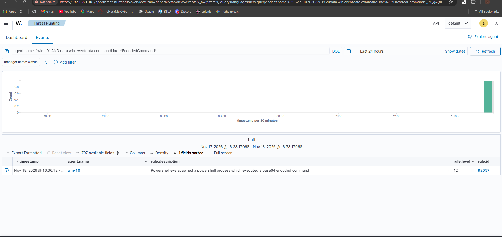
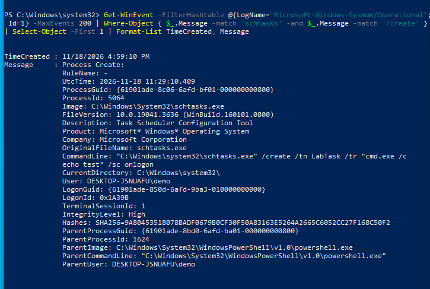
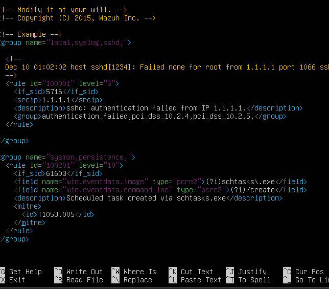
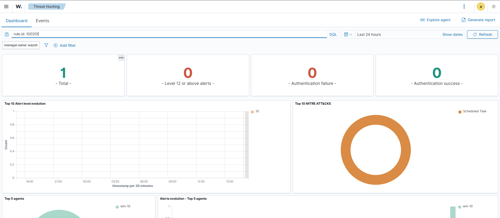
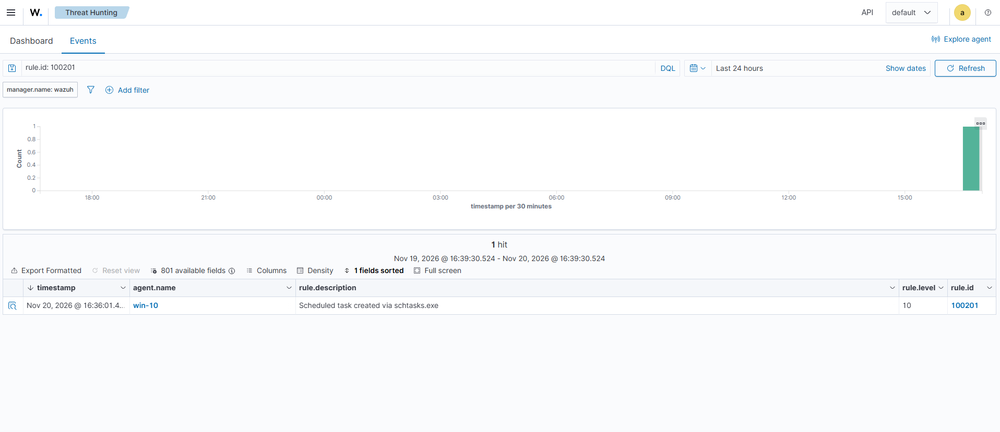
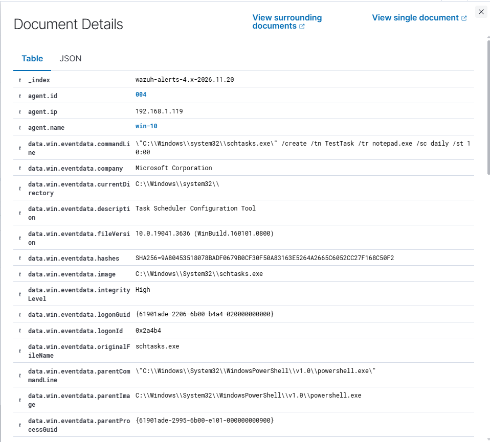
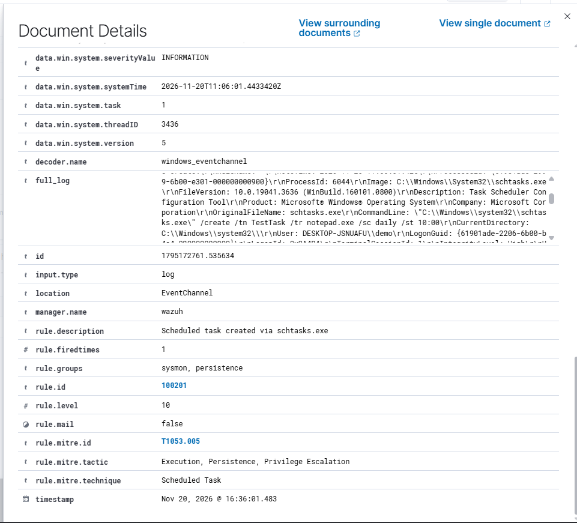
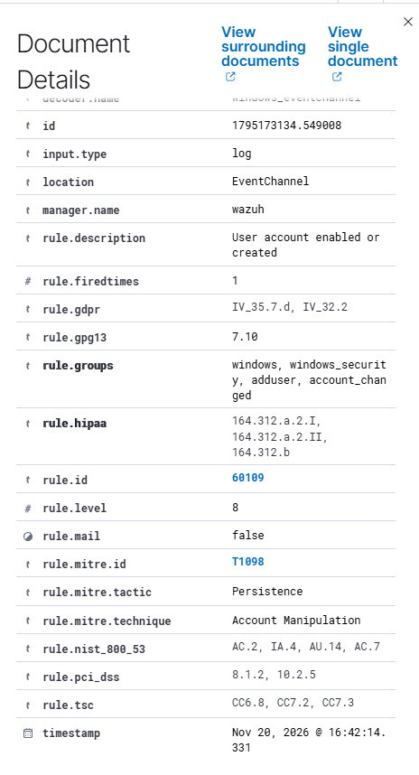
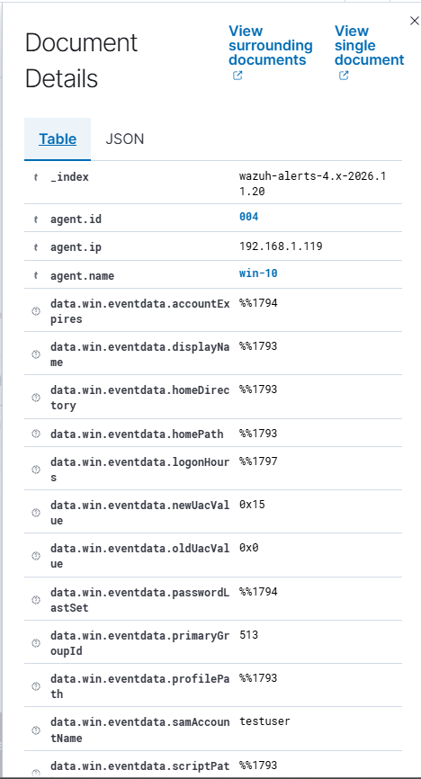
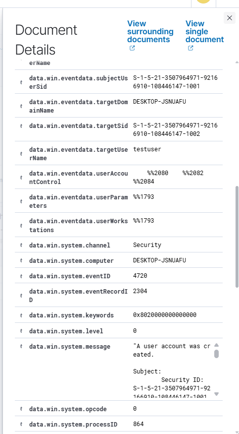

# Project 2: Sysmon + Wazuh Endpoint Detection Lab

Endpoint detection lab that uses **Sysmon** and **Wazuh** to detect common attacker techniques on a Windows 10 host, identify a **detection gap**, and close it with a **custom Wazuh rule** mapped to MITRE ATT&CK.

> Part of my SOC Analyst L1 portfolio. Project 1 (Wazuh failed-logon detection, Event ID 4625) is documented separately in this repo.

**Full report (PDF):** [Sysmon_Wazuh_Project_Report.pdf](Sysmon_Wazuh_Project_Report.pdf)

## Objective

- Collect detailed endpoint telemetry with Sysmon and forward it to Wazuh
- Simulate three attacker behaviours in a controlled lab
- Check whether Wazuh detects each one by default
- Investigate gaps and write custom detection logic where needed

## Lab Setup

- **Endpoint:** Windows 10 VM (`win-10`) with Sysmon and the Wazuh agent
- **Manager:** Ubuntu server running Wazuh Manager and Dashboard
- **Telemetry:** Sysmon Operational log (Event ID 1, process creation) and Windows Security log, forwarded via the Wazuh agent
- **Debugging:** `logall_json` was enabled temporarily to confirm Sysmon events reached the manager, then turned off

## Results Summary

- **Test 1:** Encoded PowerShell command. Detected by default rule **92057** (level 12).
- **Test 2:** Scheduled task creation via `schtasks /create` (T1053.005). **Not detected by default.** Custom rule **100201** written (level 10).
- **Test 3:** Local account creation via `net user /add`. Detected by default rule **60109** (level 8, mapped by Wazuh to T1098).

## Test 1: Encoded PowerShell Command

- **Behaviour:** PowerShell run with a base64 encoded command (`-EncodedCommand`)
- **Result:** Wazuh rule 92057, level 12, "Powershell.exe spawned a powershell process which executed a base64 encoded command"
- **Hunting query:** `agent.name: "win-10" AND data.win.eventdata.commandLine: *EncodedCommand*`
- **Evidence:**



## Test 2: Scheduled Task Persistence (Detection Gap)

- **Behaviour:** `schtasks /create` used to create a task (MITRE T1053.005, Scheduled Task)
- **Finding:** Sysmon logged the process creation (Event ID 1), with parent `powershell.exe` and High integrity level, but **Wazuh raised no alert**. The Sysmon process-creation parent rule (61603) is level 0, so nothing fires by default.
- **Fix:** Custom rule 100201 added to `/var/ossec/etc/rules/local_rules.xml`:

```xml
<group name="sysmon,persistence,">
  <rule id="100201" level="10">
    <if_sid>61603</if_sid>
    <field name="win.eventdata.image" type="pcre2">(?i)schtasks\.exe</field>
    <field name="win.eventdata.commandLine" type="pcre2">(?i)/create</field>
    <description>Scheduled task created via schtasks.exe</description>
    <mitre>
      <id>T1053.005</id>
    </mitre>
  </rule>
</group>
```

- **How the rule works:**
  - `if_sid 61603` limits it to Sysmon process-creation events
  - The `image` field matches `schtasks.exe`
  - The `commandLine` field matches `/create`, so `/query` and `/delete` do not alert
- **Validation:** Rule syntax checked with `wazuh-analysisd -t`, manager restarted, test re-run. Wazuh fired rule 100201 (level 10, `rule.mitre.id: T1053.005`, tactics Execution, Persistence, Privilege Escalation). Dashboard query: `rule.id: 100201`
- **Evidence:**

Before: Sysmon captured the `schtasks /create` event, but Wazuh raised no alert.



Custom rule 100201 as written in `local_rules.xml` on the manager:



After: Wazuh dashboard showing the rule 100201 alert and its MITRE mapping.





Alert details (command line, parent process, integrity level):



Rule and MITRE fields (T1053.005):



## Test 3: Local Account Creation

- **Behaviour:** `net user testuser <password> /add` (intended technique: T1136.001, Create Account: Local Account)
- **Result:** Wazuh default rule 60109, level 8, "User account enabled or created", Windows Event ID 4720
- **Note:** Wazuh maps this rule to **T1098 (Account Manipulation)**, not T1136.001. Noted here so the mapping difference is clear.
- **Details captured:** `samAccountName: testuser`, `oldUacValue: 0x0`, `newUacValue: 0x15`, `primaryGroupId: 513`
- **Note on `%%1793`, `%%1794`, `%%1797`:** Windows resource placeholders meaning "not set", "never" and "all"
- **Evidence:**







## MITRE ATT&CK Mapping

- **Test 1:** PowerShell encoded command (T1059.001 is the behaviour simulated)
- **Test 2:** T1053.005, Scheduled Task/Job: Scheduled Task
- **Test 3:** Wazuh maps to T1098, Account Manipulation (simulated behaviour: T1136.001)

## Key Takeaways

- Telemetry collected is not the same as telemetry alerted on. Sysmon captured the schtasks event, but Wazuh needed a custom rule to alert on it.
- Writing a rule needs exact field names. Wazuh field names are case-sensitive (`commandLine`, not `commandline`), and a wrong case passes the syntax check but never matches.
- Every test was cleaned up afterwards (test task and test user removed, `logall_json` turned off).

## Skills Demonstrated

Sysmon deployment, Wazuh agent and manager administration, custom rule writing (`local_rules.xml`), log analysis, threat hunting with DQL, MITRE ATT&CK mapping, detection gap analysis, documentation.

## Repository Structure

```
Project-2-Sysmon-Wazuh/
├── README.md
├── Sysmon_Wazuh_Project_Report.pdf
└── screenshots/screenshots/   (evidence images used above)
```

The full write-up with all evidence is in [Sysmon_Wazuh_Project_Report.pdf](Sysmon_Wazuh_Project_Report.pdf).

## Disclaimer

All activity was performed in an isolated lab environment that I own. The test task and test account were removed after each test.
